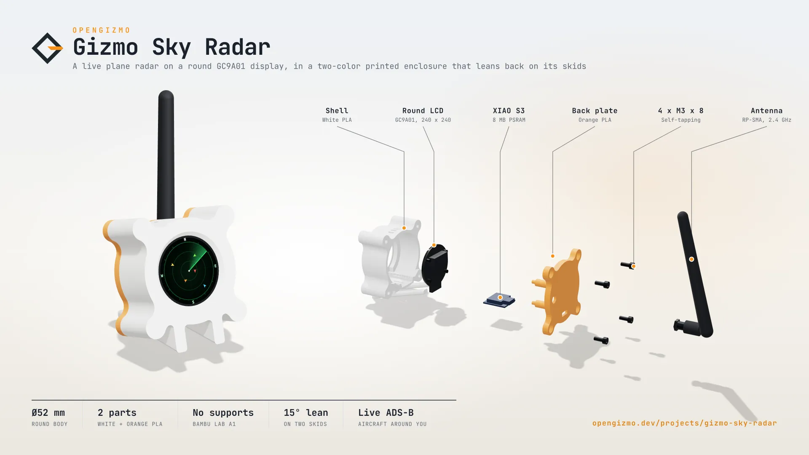
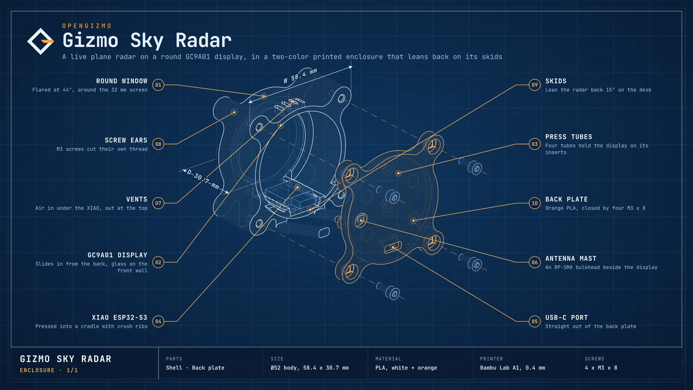
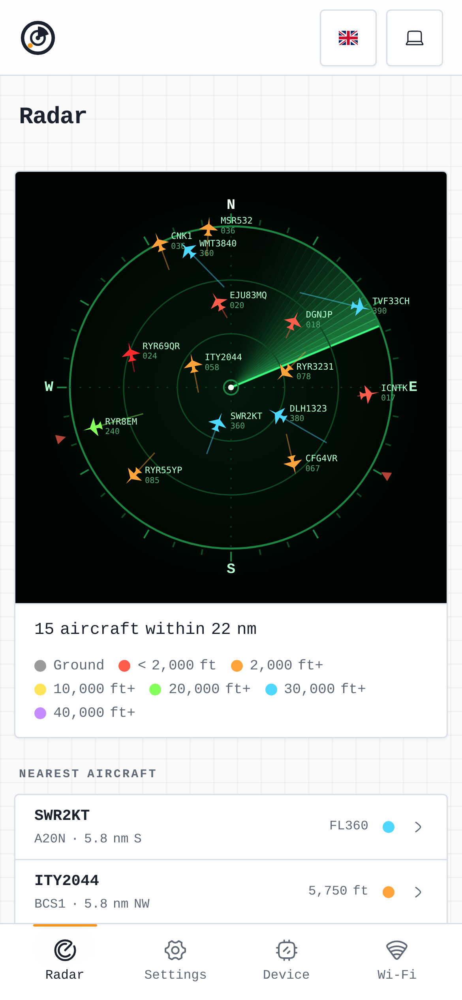
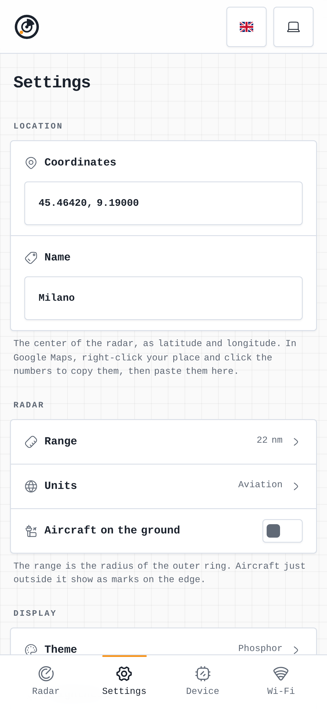
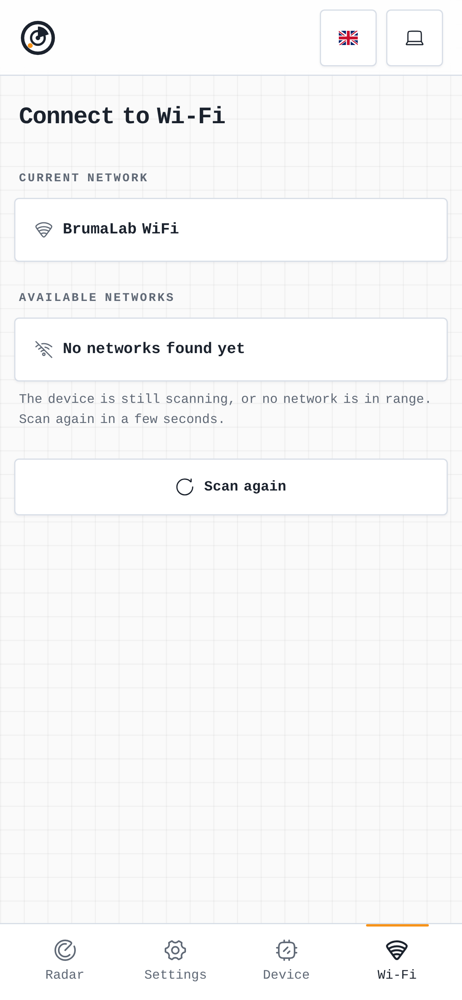

<div align="center">

# 🛩️ Gizmo Sky Radar

### A live plane radar for your desk

Gizmo Sky Radar is a two-part project that turns a Seeed Studio XIAO ESP32-S3 and a GC9A01 round display into a little radar screen that shows the aircraft flying around your home, live: ESP32 firmware that downloads the flight data from adsb.fi and draws it on the display, and a Nuxt 4 web app, built into the firmware, to set it up and watch the sky from your phone.

<p>
  <a href="https://opengizmo.dev/projects/gizmo-sky-radar"></a>
</p>

<p>
  <a href="https://github.com/open-gizmo/gizmo-sky-radar"></a>
  
  
  
  
</p>

<p>
  📡 Live ADS-B data from adsb.fi • 🟢 Animated radar on a round display • ✈️ Smooth motion between updates • 🎨 Three themes • 📱 Wi-Fi setup from the phone • 🌍 EN/IT UI
</p>

<p>
	<a href="#enclosure"><strong>Enclosure</strong></a> •
	<a href="#overview"><strong>Overview</strong></a> •
	<a href="#images"><strong>Images</strong></a> •
	<a href="#features"><strong>Features</strong></a> •
	<a href="#architecture"><strong>Architecture</strong></a> •
	<a href="#quick-start"><strong>Quick Start</strong></a> •
	<a href="#hardware"><strong>Hardware</strong></a> •
	<a href="#firmware-overview"><strong>Firmware Overview</strong></a> •
	<a href="#configuration"><strong>Configuration</strong></a> •
	<a href="#troubleshooting"><strong>Troubleshooting</strong></a> •
	<a href="#license"><strong>License</strong></a>
</p>

</div>

<a id="enclosure"></a>
## 📐 Enclosure

<div align="center">
	
	<p>
		<sub>The two-color printed enclosure: a round white shell that leans back 15° on two skids, and an orange back plate with the antenna mast, closed by four M3 screws</sub>
	</p>
</div>

<a id="overview"></a>
## 📘 Overview

Look up when a plane flies over and you probably wonder where it's going. Gizmo Sky Radar answers before you ask: a round screen on your desk with a radar beam sweeping over the aircraft around your home, each one turned to its course, colored by its altitude, with its callsign next to it and a short trail behind.

You set the location once, from your phone, and pick how far the radar looks: from 5 km, where you see the helicopters and the small planes over your neighborhood, to 150 km, a whole region of airliners. Every 5 seconds the radar downloads the aircraft around that point from [adsb.fi](https://adsb.fi), a community network of ADS-B receivers, and between two downloads it moves each one along its track, so they glide instead of jumping. Every few seconds a spotlight moves to one of the nearest aircraft and the bottom of the screen tells you what it is, how high and how fast it flies, and how far away it is.

The web app built into the firmware shows the same radar, live, with the list of the nearest aircraft and the details of each one.

<a id="images"></a>
## 🖼️ Images

### Screenshots

<div align="center">
	<table>
		<tr>
			<td align="center" valign="top">
				
			</td>
			<td align="center" valign="top">
				
			</td>
			<td align="center" valign="top">
				
			</td>
		</tr>
	</table>
	<p>
		<sub>Radar, settings, and WiFi setup screens (the web app's development server, with a simulated sky over Milan)</sub>
	</p>
</div>

<a id="features"></a>
## ✨ Features

- A radar on the 240 × 240 round display: range rings, a compass, a sweeping beam that makes the aircraft glow as it passes, and about 25 frames a second, drawn off screen and pushed in one go so nothing flickers.
- Aircraft drawn as small airplanes turned to their track, colored by altitude (the same colors in the web app), with their callsign, their altitude in hundreds of feet, an arrow when they climb or descend, and a trail of the last minute.
- Smooth motion: between two downloads, each aircraft moves on along its track at its ground speed (dead reckoning).
- Aircraft just outside the range show as marks on the edge of the display, pointing to where they are.
- A spotlight on the nearest aircraft, one after another, with its name, type, altitude, speed, distance and direction at the bottom of the screen.
- Emergencies (squawk 7500, 7600 or 7700) blink in red.
- Settings from the web app: the location (paste the coordinates from any map), a name for it, the range (5 to 150 km), the units (aviation, metric or imperial), the theme (Phosphor, Amber or Arctic), the brightness, the rotation of the picture, and the beam, the labels, the trails and the ground traffic on or off.
- Screens for every state: a boot animation, the Wi-Fi setup, the connection, a radar without a location, and the countdown of the factory reset.
- Downloads in a task of their own, so the display never waits for the network, with a growing pause after failures and a warning on screen when the data gets old.
- A small HTTP API (`/api/aircraft`, `/api/config`, `/api/settings`) that scripts and other devices can call directly.
- A Markdown guide for AI agents at `/llms.txt`, describing the API with the address of the radar filled in.
- Nuxt 4 interface with the live radar, the list of the nearest aircraft and their details, built on the `@brumaombra/ui-vintage` UI system.
- English and Italian localization.
- Captive-portal setup flow in AP mode and `gizmo-sky-radar.local` hostname access after joining Wi-Fi. The API only answers the dashboard's own page and direct requests (scripts, `curl`), under the radar's own name or address, and through the setup hotspot only the Wi-Fi setup.
- Factory reset with the BOOT button, with a countdown on the display.
- Flashable from the browser on [opengizmo.dev](https://opengizmo.dev/projects/gizmo-sky-radar), with versioned releases.

<a id="architecture"></a>
## 🏗️ Architecture

Gizmo Sky Radar is built around three cooperating parts:

- 🔌 **ESP32-S3 firmware** downloads the flight data, follows the aircraft, draws the radar, and runs the Wi-Fi and the embedded HTTP server.
- 🟢 **GC9A01 round display**, 240 × 240 pixels over SPI at 80 MHz, with its backlight dimmed by PWM.
- 🌐 **Nuxt web app** provides the browser-based setup and the live radar, with theme, language, and shared UI-system support.

### 🔄 Data Flow

1. Every 5 seconds, a task of the firmware asks adsb.fi for the aircraft within a radius a bit larger than the range (`https://opendata.adsb.fi/api/v3/lat/{lat}/lon/{lon}/dist/{nm}`).
2. It reads the answer into the PSRAM, keeps the fields the radar uses, and hands the nearest 64 aircraft to the tracker, which keeps their trails and holds on to the ones that miss a download for a while.
3. The display copies the tracker about 25 times a second, moves each aircraft on from its last position along its track, and draws the frame.
4. The web app reads the same aircraft from `GET /api/aircraft` every 5 seconds and moves them on the same way.

<a id="quick-start"></a>
## 🚀 Quick Start

### 🚀 Easy, no-code option

Use this path if you just want to flash the prebuilt firmware from the website. You do not need VS Code, PlatformIO, or a local build step.

1. **Wire the display to the XIAO ESP32-S3** (see [Pinout](#pinout)), **and connect the board to an available USB port on your PC.**

2. **Open the [Gizmo Sky Radar](https://opengizmo.dev/projects/gizmo-sky-radar) project page.**

3. **Scroll down until you reach the firmware flashing card.**

4. **Press the "Flash firmware" button in the card to start the upload.**

	If the flasher can't connect, hold the **BOOT** button of the XIAO, press and release **RESET**, then release **BOOT** and try again: this puts the ESP32-S3 in flashing mode by hand.

5. **Wait until the flashing process completes, then press RESET.**

6. **Join the `Gizmo-Sky-Radar` Wi-Fi network with your phone, and pick your Wi-Fi in the page that opens.** The display tells you what to do.

7. **Open [gizmo-sky-radar.local](http://gizmo-sky-radar.local), go to Settings and paste the coordinates of your home.** Enjoy your Gizmo Sky Radar!

### 🛠️ More technical option

If you want to build and flash everything yourself, follow this path:

1. **Install Visual Studio Code and PlatformIO.**

	Open the repository in VS Code, then install the PlatformIO extension so you can build and upload the firmware from the editor. The firmware project lives in `microcontroller/`, and PlatformIO uses the settings defined in `microcontroller/platformio.ini`.

2. **Build the app UI first.**

	The web app lives in `webapp/` and needs Node.js 24.21 or newer. From that folder, install the exact dependencies of the lockfile and build the embedded UI bundle:

	```bash
	npm ci
	npm run build:embedded
	```

	This runs the Nuxt static build, then the `gizmo-embed` tool from [gizmo-common](https://github.com/open-gizmo/gizmo-common) turns it into gzipped C++ assets for the firmware. Re-run it any time you change the web UI, translated labels, or embedded pages.

3. **Build the microcontroller code.**

	Open `microcontroller/` in PlatformIO and run the firmware build. From the CLI, the equivalent command is:

	```bash
	pio run
	```

	This compiles the firmware for the XIAO ESP32-S3 together with the current web UI assets and the libraries declared in `platformio.ini`.

4. **Upload the firmware to the ESP32-S3.**

	After a successful build, upload the firmware to the board from the PlatformIO toolbar or with:

	```bash
	pio run --target upload
	```

	The released firmware keeps the serial log off. To see it, flash the `debug` build profile (see [Build profiles](#build-profiles)):

	```bash
	pio run -e debug --target upload
	pio device monitor
	```

<a id="hardware"></a>
## 🔌 Hardware

### Board

The firmware targets the **Seeed Studio XIAO ESP32-S3** (PlatformIO board `seeed_xiao_esp32s3`). Its 8 MB of PSRAM hold the frame of the display and the downloaded flight data, so the firmware needs a module that has it (every XIAO ESP32-S3 does).

Besides the board, the radar needs:

- **GC9A01 round display**, 1.28", 240 × 240, with an SPI interface (the common module with VCC, GND, DIN, CLK, CS, DC, RST and BL pins).

### Pinout

| Display | XIAO ESP32-S3 | GPIO | What it does |
| --- | --- | --- | --- |
| VCC | 3V3 | | 3.3 V power supply |
| GND | GND | | Ground |
| DIN | D10 | `9` | Pixel data (MOSI) |
| CLK | D8 | `7` | SPI clock |
| CS | D1 | `2` | Chip select |
| DC | D2 | `3` | Data or command |
| RST | D3 | `4` | Reset |
| BL | D0 | `1` | Backlight, dimmed with PWM (wire it to 3V3 instead to keep it always at full brightness) |

The pins are in [microcontroller/src/config/pins.h](microcontroller/src/config/pins.h). The BOOT button (GPIO0) is the factory reset, and is never wired to the display.

### Display

- Controller: `GC9A01`, driven by [LovyanGFX](https://github.com/lovyan03/LovyanGFX) over SPI at 80 MHz
- Resolution: 240 × 240, round
- Frame: drawn into a 16-bit sprite in the PSRAM and pushed whole, about 25 frames a second
- Orientation: set in the web app (Settings > Rotation), to match how the display sits in its case

<a id="firmware-overview"></a>
## 🔍 Firmware Overview

### ⚙️ General

The firmware is responsible for the runtime behavior of the physical radar.

- Draws the radar and its status screens on the round display.
- Connects the ESP32-S3 to Wi-Fi, and opens a setup hotspot when there is no working network.
- Downloads the aircraft around the location from adsb.fi every 5 seconds, in a task of its own.
- Follows the aircraft across downloads, with their trails, and moves them on between downloads.
- Hosts the embedded HTTP server and the radar API.
- Saves the settings in the flash, and forgets them (and the Wi-Fi) on a factory reset.

### 🧩 Firmware Layers

The firmware is split into focused modules under `microcontroller/src/`:

- ⚙️ `config/` holds the project name, the pins of the display, the shared web server, and the settings of the radar with their limits and JSON (`radar_settings.*`, hardware-free).
- 💾 `storage/` saves the settings with `Preferences`.
- ✈️ `flights/` downloads the flight data in its own task (`flights.*`), and keeps hardware-free the parser of the readsb JSON (`aircraft_parser.*`), the tracker with the trails and the dead reckoning (`aircraft_tracker.*`), the download schedule (`fetch_schedule.*`), the geography (`geo.*`) and the JSON of an aircraft (`aircraft_json.*`).
- 🟢 `display/` drives the GC9A01 (`panel.h`), picks the screen (`display.*`), draws the radar (`radar_view.*`) with the colors of `theme.*`, and writes the numbers in the units of the user (`units.*`, hardware-free).
- 📖 `guide/` writes the Markdown guide for AI agents (`agent_guide.*`), hardware-free.
- 🌐 `server/` exposes the embedded HTTP routes (`/api/config`, `/api/settings`, `/api/reset-settings`, `/api/aircraft`, `/llms.txt`, and the web app).
- 🧾 `serial/` turns on the serial log in the debug build.
- 🔌 `wifi/` gives the radar's names to the shared Wi-Fi setup, and tells the display how the connection is doing.

### 🧪 Tests

The hardware-free logic (the settings, the parser, the tracker, the download schedule, the geography, the units and the guide for agents) is tested on your computer, no board needed:

```bash
cd microcontroller
pio test -e native
```

The tests live in [microcontroller/test/](microcontroller/test/). They need a C++ compiler on your computer (GCC or Clang), and also run in the release workflow before the firmware is built.

The web app has its own tests (its pages, the mock device API, the formatting and the translations), with Vitest:

```bash
cd webapp
npm test
```

They live in [webapp/tests/](webapp/tests/), and [webapp/tests/README.md](webapp/tests/README.md) explains how they are built.

Logging, the web API helpers, the device API, the factory reset and the whole Wi-Fi setup (connection, setup hotspot, captive portal, and the `/api/networks`, `/api/connect` and `/api/check-connection` endpoints) come from the shared [gizmo-common](https://github.com/open-gizmo/gizmo-common) library, which has its own tests.

### 🌐 Web App Overview

The Nuxt app provides the browser-based setup and the live radar.

- Shows the radar live, like the display, with the beam, the trails and the labels, the aircraft moving on between reads; tap one to see its details.
- Lists the nearest aircraft with their type, altitude, distance and direction, and opens each one on the adsb.fi map.
- Sets the location, the range, the units, the theme, the brightness, the rotation and what the display shows.
- Lets users configure Wi-Fi, restart the device, and reset its settings.
- Supports English and Italian localization.
- Uses the `@brumaombra/ui-vintage` package for the shared design system.
- Keeps device API helpers and radar state in `webapp/app/composables/`.
- Uses static generation for the embedded web UI bundle that is packaged into firmware assets.
- During development (`npm run dev`), a mock device in `webapp/server/` answers like the firmware, with a simulated sky over Milan (and one aircraft squawking 7700, to show how an emergency looks).

#### 🎨 UI System

The web app splits UI responsibilities between the shared packages and the app itself.

- `@brumaombra/ui-vintage` provides the reusable UI system.
- The gizmo-common web layer provides the dashboard layout, the Wi-Fi pages, the device card, and the mock device for the Wi-Fi and device routes.
- `webapp/app/pages/radar.vue` is the live radar, `webapp/app/pages/settings.vue` the settings, `webapp/app/pages/device.vue` holds the device card, and `webapp/app/app.config.ts` sets the name, logo and navigation for the layer.
- `webapp/app/components/RadarScope.vue` draws the radar in SVG, with the colors of the display.
- `webapp/app/assets/css/main.css` imports the shared library and layer stylesheets.
- `webapp/app/composables/useRadar.js` and `webapp/app/composables/stores/useGlobalStore.js` keep the settings and the last aircraft local to the app, and `webapp/app/composables/useUtils.js` has the units, colors and geography shared with the firmware.

<a id="configuration"></a>
## ⚙️ Configuration

### Build profiles

[platformio.ini](microcontroller/platformio.ini) has the same three profiles as every OpenGizmo firmware:

- `release`, the default: the firmware the release workflow builds and the website flashes, with the serial log off.
- `debug`: the same firmware with the serial log on, and the ESP32 core's own messages, including the time each frame takes to draw and to push. Flash it with `pio run -e debug --target upload`, then open `pio device monitor`.
- `native`: the tests of the hardware-free logic, on your computer (`pio test -e native`).

Nothing needs a secrets file: the Wi-Fi and the location are set from the phone and saved on the board.

### Settings

| Setting | Values | Default |
| --- | --- | --- |
| Location | Latitude and longitude, and an optional name (up to 24 characters) | None: the radar asks for one |
| Range | The radius of the outer ring: 5, 10, 20, 40, 80 or 150 km | 40 km |
| Units | Aviation (nm, ft, flight levels, kt), metric (km, m, km/h) or imperial (mi, ft, mph) | Aviation |
| Theme | Phosphor (green), Amber or Arctic (cyan on blue) | Phosphor |
| Brightness | 5 to 100% | 80% |
| Rotation | 0°, 90°, 180° or 270° | 0° |
| Radar beam, labels, trails | On or off | On |
| Aircraft on the ground | On or off | Off |

### Radar API

The radar answers on `http://gizmo-sky-radar.local` (or its IP address) on your network:

| Request | Response |
| --- | --- |
| `GET /api/aircraft` | JSON with the center, the range, the state of the data and the aircraft, nearest first, with their trails |
| `GET /api/config` | JSON with the settings |
| `POST /api/settings` | Saves the settings in the body (only the fields sent change), and answers the saved settings |
| `POST /api/reset-settings` | Forgets the settings and the Wi-Fi, then restarts into the setup hotspot |
| `GET /api/device` | JSON with the firmware version, uptime, memory, network and signal (from gizmo-common) |

```sh
curl "http://gizmo-sky-radar.local/api/aircraft"
```

Each aircraft has its `hex` (ICAO address), `callsign`, `registration`, `type`, `description`, `squawk`, `latitude` and `longitude` with their `positionAgeSeconds`, `onGround`, `altitudeFt`, `groundSpeedKt`, `trackDegrees`, `verticalRateFpm`, `emergency`, its `distanceKm` and `bearingDegrees` from the radar, `inRange`, and `missing` when it wasn't in the last download. The `status` of the data is `live`, `loading`, `stale`, `error`, `waiting_for_network` or `no_location`. Errors are JSON, in the format of every OpenGizmo device: `{ "errorId": "invalid_settings_field", "errorMessage": "rangeKm", "data": null }`.

### Guide for AI agents

The radar describes itself in Markdown for agents that read before they connect: the HTTP API and tips, with the address the agent used already filled in. It is served at `/llms.txt`, at `/` to clients whose `Accept` header asks for `text/markdown` before `text/html` (browsers still get the web app), and every page of the web app links to it with `<link rel="alternate" type="text/markdown">`.

### Flight data

The aircraft come from the [adsb.fi open data API](https://opendata.adsb.fi), a free community network of ADS-B receivers. The radar asks it for a radius a little larger than its range (30% more, up to 250 nm), every 5 seconds, which keeps it well under the rate limit of the API. After a failed download it waits 5 seconds, then twice as long after each failure in a row, up to a minute (30 seconds after a "too many requests"); after a minute without data the display says how old the aircraft are. Coverage depends on the receivers near you: low flights far from a receiver may not show.

### Runtime Flow

The device is configured through its embedded web UI and local network flow.

1. The XIAO starts in access point mode on first boot, as the `Gizmo-Sky-Radar` network, and the display says so.
2. The web app lets you pick the Wi-Fi network and enter its password from your phone.
3. The firmware saves the network and reuses it after reboot.
4. At `gizmo-sky-radar.local`, the Settings page sets the location, and the radar starts.

### Factory reset

Hold the **BOOT** button of the XIAO for 10 seconds while the radar runs: the display counts down, then the radar forgets its settings and its Wi-Fi and restarts into the setup hotspot. Release the button earlier to cancel. The Device page of the web app does the same with **Reset all settings**.

### Key Files

- `microcontroller/src/display/radar_view.cpp` for the drawing of the radar.
- `microcontroller/src/display/theme.cpp` for the colors of the themes and the altitudes.
- `microcontroller/src/flights/flights.cpp` for the downloads.
- `microcontroller/src/flights/aircraft_tracker.cpp` for the trails and the dead reckoning.
- `microcontroller/src/config/radar_settings.cpp` for the settings, their limits and their validation.
- `webapp/app/components/RadarScope.vue` for the radar of the web app.
- `webapp/app/composables/useDeviceApi.js` for browser-to-device communication.

### Releasing a new version

Versions follow [semantic versioning](https://semver.org) (`vMAJOR.MINOR.PATCH`), in the `VERSION` file: a bug fix bumps the patch (1.0.1), a new feature that keeps the saved settings bumps the minor (1.1.0), and a change that resets the settings or needs new wiring bumps the major (2.0.0).

1. On `feature`, set the new version in `VERSION` and in `webapp/package.json` (`npm version X.Y.Z --no-git-tag-version` in `webapp/` updates its lockfile too), and move the notes under **Unreleased** in [CHANGELOG.md](CHANGELOG.md) under a `## vX.Y.Z - YYYY-MM-DD` heading.
2. Bring `main` up to `feature`.
3. Run the **Build & Release 📦** workflow by hand (Actions > Build & Release > Run workflow, on `main`). It checks the version is new and matches the web app, runs the tests, builds the web app and the firmware (which reports its version in `/api/device`), and creates the GitHub Release `vX.Y.Z` with the four flash parts and the notes of `CHANGELOG.md` (it stops before building anything when the version has no notes, or notes are left under Unreleased).
4. The same parts go to Cloudflare R2, with a `manifest.json` that lists each part and its flash address. The flash button on [opengizmo.dev](https://opengizmo.dev/projects/gizmo-sky-radar) reads that manifest, so it always installs the latest release, and keeps the saved settings. The CDN caches the manifest for 60 seconds only, so the website offers a new release within a minute, with no purge.

The workflow only runs on `main`, and needs these secrets, on the repository or on the open-gizmo organization: `R2_ACCOUNT_ID`, `R2_ACCESS_KEY_ID`, `R2_SECRET_ACCESS_KEY` (an R2 API token limited to the bucket) and `R2_BUCKET`. It checks them first, and stops before releasing anything when one is missing.

<a id="troubleshooting"></a>
## 🧰 Troubleshooting

- The display stays black: check VCC, GND and BL (or wire BL to 3V3), and that DIN, CLK, CS, DC and RST go to the pads of the [Pinout](#pinout).
- The picture is upside down or sideways: set the rotation in Settings > Rotation.
- The colors look wrong or inverted: your module may be a GC9A01 variant with another color order. Change `invert` or `rgb_order` in [microcontroller/src/display/panel.h](microcontroller/src/display/panel.h).
- Lines or noise on the display: long or loose wires can't carry 80 MHz. Shorten them, or lower `DISPLAY_SPI_FREQUENCY` in `panel.h` to 40 MHz.
- The display says "ALMOST READY": the radar has no location yet. Open `gizmo-sky-radar.local` and set it in Settings.
- The display says "NO DATA - RETRYING" or "DATA … MIN OLD": the radar can't reach adsb.fi. Check that your network reaches the internet; the radar keeps retrying by itself, and the web app shows the error.
- "CLEAR SKY" for a long time: there may really be no traffic, or no ADS-B receiver near you. Try a larger range.
- The web UI does not open after joining Wi-Fi: make sure your phone or computer is on the same network as the radar and try the `gizmo-sky-radar.local` hostname if your router supports mDNS, or the IP address shown by your router.
- The flasher can't connect to the board: try another USB cable (some only charge), and use the BOOT and RESET buttons to enter flashing mode by hand (see [Quick Start](#quick-start)).
- The AP setup flow never appears: power-cycle the device and check the firmware logs (the `debug` build profile) for Wi-Fi connection errors.

<a id="license"></a>
## 📄 License

This project is licensed under the MIT License. See [LICENSE](LICENSE) for details. The flight data comes from [adsb.fi](https://adsb.fi), under its own terms.

---

<p align="center">
	
	<br/>
	<strong>Real projects. Real hardware. Real fun.</strong>
	<br/>
	<sub>A small corner of the internet for ESP32 builds that are useful, remixable, and actually fun to use.</sub>
</p>
